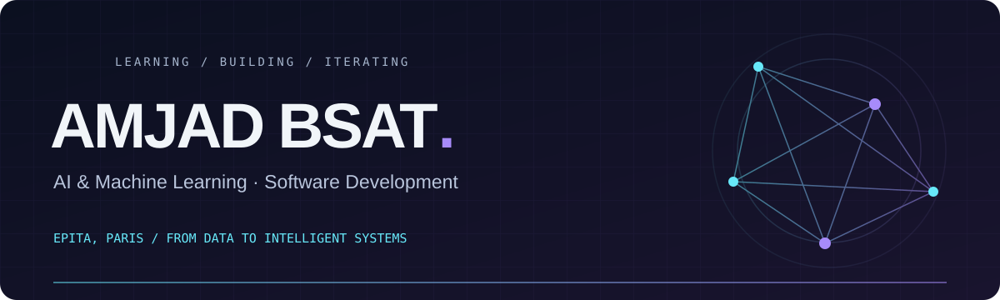

  

  

  
  

### A little about me

I'm **Amjad Bsat**, an AI & Machine Learning student pursuing an **MSc in Artificial Intelligence Systems at EPITA, Paris**, with a bachelor's degree in Computer Science.

I enjoy turning data and ideas into practical applications—from machine learning pipelines to document assistants and computer vision.

- **Building:** AI applications, data pipelines, and software that connects them.
- **Exploring:** deep learning, retrieval-augmented generation, and agentic AI.
- **Learning:** cloud architecture, MLOps, and deploying models as useful products.

### My toolkit

**Languages**

**AI, applications & infrastructure**

### Selected projects

| Project | What I built | Tools |
| :--- | :--- | :--- |
| **🏎️ F1 Race Prediction** | An end-to-end race prediction project combining machine learning, data pipelines, model tracking, and a prediction interface. | Python · Docker · Airflow · MLflow · Streamlit |
| **🤖 EU AI Act RAG Agent** | A team-built document assistant with evidence retrieval, page citations, source highlighting, conversation memory, and evaluation. | Python · FAISS · OpenAI API · Gradio · SQLite |
| **👁️ Face Recognition Attendance** | A computer vision system that identifies registered users and records attendance. | Python · OpenCV · Computer Vision |

### Activity, one contribution at a time

<picture>
  <source media="(prefers-color-scheme: dark)" srcset="https://raw.githubusercontent.com/Amjad-dev45/Amjad-dev45/output/github-snake-dark.svg?v=1" />
  <source media="(prefers-color-scheme: light)" srcset="https://raw.githubusercontent.com/Amjad-dev45/Amjad-dev45/output/github-snake.svg?v=1" />
  
</picture>

GitHub stats

 

Cards depend on an external service. Language statistics reflect public repository code.

---

Curiosity → experiments → useful software.

